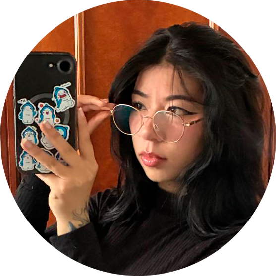

# Etapa 1 - Reconocimiento del entorno y armado de equipos con SCV

**Equipo:** The Primegame  
**Curso:** Programación para Videojuegos (213027A)  
**Repositorio:** público · Tag de entrega: `v1.0`

## Descripción del proyecto

El equipo The Primegame planea y desarrolla, a lo largo del curso, un prototipo digital en Unity de un videojuego de construcción con bloques estructurados, con propósito educativo y social. La propuesta se inspira en experiencias como LEGO Duplo, bloques de madera geométricos y construcciones magnéticas: piezas claras, modelos de pocos pasos y feedback inmediato, pensadas para niñas y niños con autismo —y para quienes los acompañan— que se benefician del orden, la repetición y el control al jugar.

El objetivo del prototipo es facilitar la participación y el aprendizaje mediante mecánicas de ensamblaje guiado, planificación simple y comprobación visual de lo construido. En esta Etapa 1 el equipo se organiza con roles de la industria, canal de comunicación y un repositorio remoto con control de versiones; cada integrante documenta su perfil en el README y evidencia su aporte con commits propios hasta el tag v1.0.

## Integrantes y perfiles

### Selena Alejandra Ortiz Zambrano

- **Ubicación:** Bogotá, Colombia  
- **Rol de industria:** Game Designer / gestora del repositorio  
- **Plato favorito:**  

**Perfil**  
Soy estudiante de Ingeniería Multimedia, con especial interés en el diseño gráfico, la ilustración y la edición de video. En este proyecto asumo el rol de gestora del repositorio y aporto en el diseño del juego, con disposición de seguir fortaleciendo mis habilidades en cada etapa del desarrollo.

---

### Julian Esteban Tunjuelo Henao

- **Ubicación:** Bogotá, Colombia  
- **Rol de industria:** Game Programmer / Gameplay Programmer  
- **Plato favorito:**  

**Perfil**  
Soy estudiante de Ingeniería Multimedia, con intereses en el desarrollo front-end de software. En este proyecto aporto desde la programación del prototipo y el trabajo colaborativo con control de versiones.

## Roles del equipo

| Integrante | Rol de industria | Rol en el repo |
|---|---|---|
| Selena Ortiz | Game Designer | Gestora del repositorio |
| Julian Tunjuelo | Game Programmer | Colaborador |

### Luisa Sanabria Lujan

- **Ubicación:** Bogotá, Colombia  
- **Rol de industria:** QA Tester
- **Plato favorito:**  

**Perfil**  
Soy estudiante de Ingeniería Multimedia, con intereses en el Desarrollo de videojueos. En este proyecto probare el minijuego con la lista de WCAG 2.2/DUA, redactar el Reporte de accesibilidad
## Roles del equipo

| Integrante | Rol de industria | Rol en el repo |
|---|---|---|
| Selena Ortiz | Game Designer | Gestora del repositorio |
| Julian Tunjuelo | Game Programmer | Colaborador |
| Luisa Sanabria | QA TESTER | Colaborador |

## Estructura del repositorio

- `SelenaOr/` — aportes y evidencias de Selena  
- `Julian_Tunjuelo/` — aportes y evidencias de Julian
- `LuisaSanabriaLuján` — aportes y evidencias de Luisa
- `README.md` — este archivo (perfiles consolidados en `main`)
